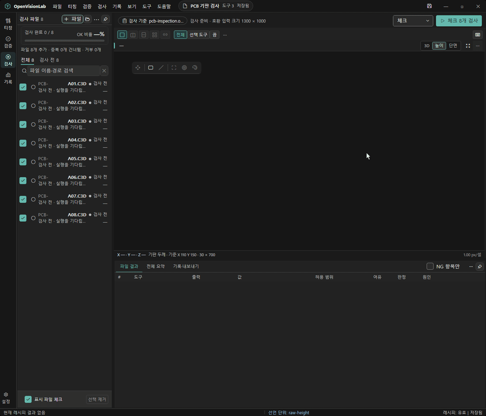
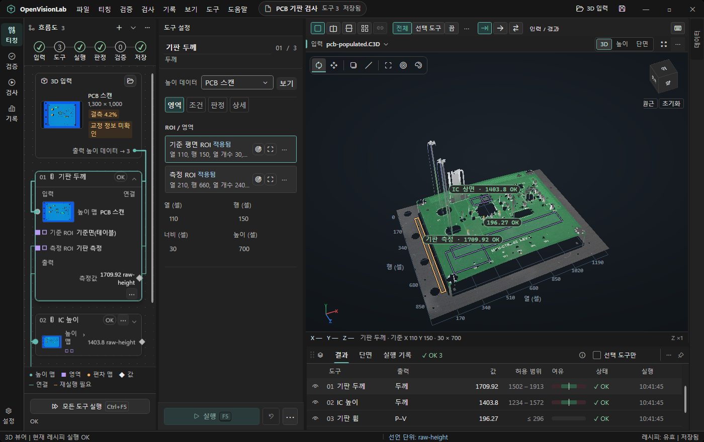
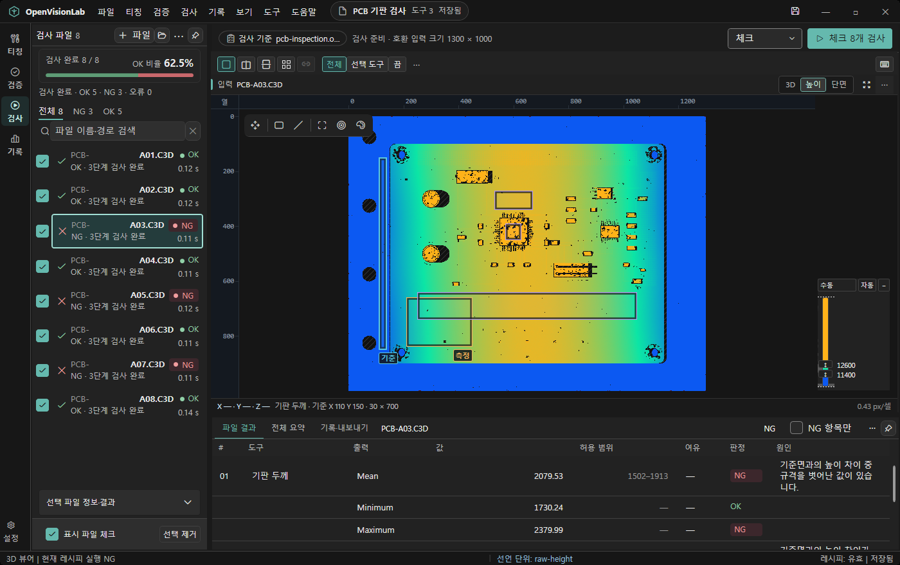
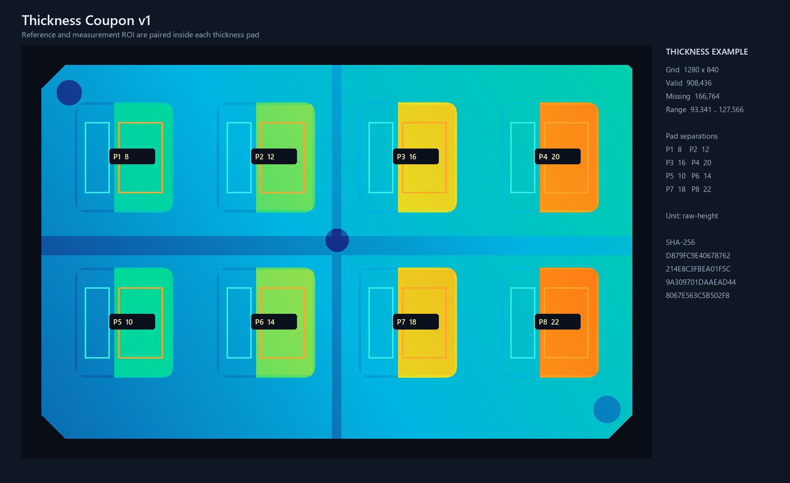
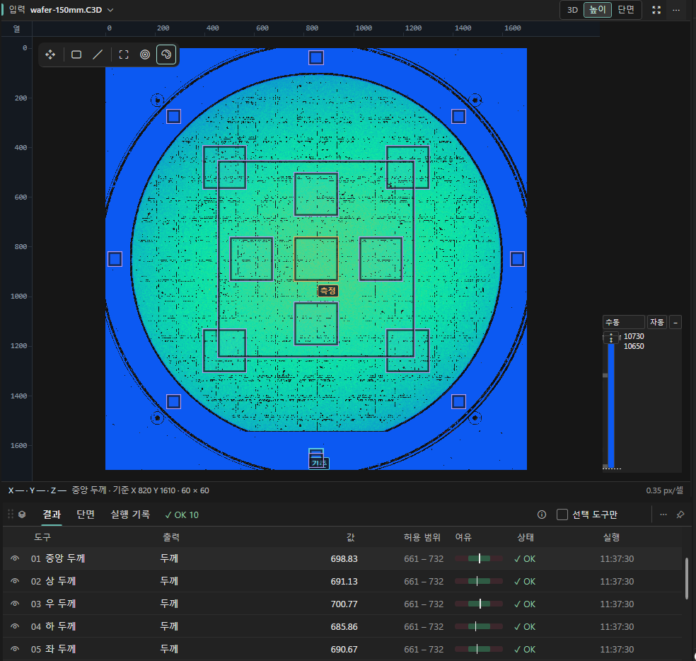
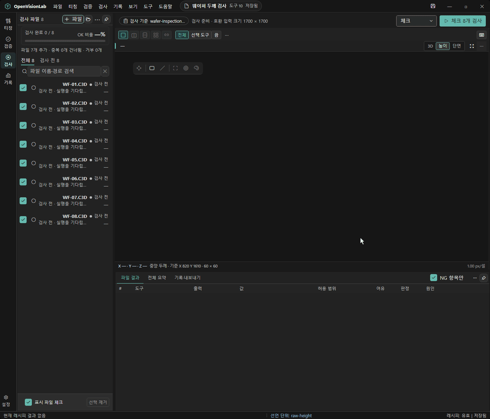
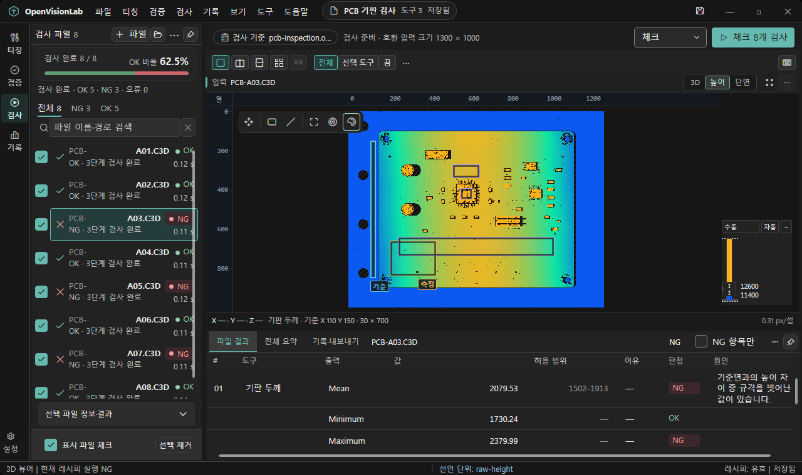

# OpenVisionLab 3D Studio

[English](README.md) | 한국어

3D 검사 조건을 티칭하고 레시피로 저장해 같은 형식(C3D)의 여러 파일에 반복 적용합니다.

로컬 3D 데이터의 규칙 기반 검사 조건을 설정하고 검사를 반복하는 Windows 데스크톱 앱입니다.
도구 입력을 연결하고 검사 영역과 하한·상한을 설정한 뒤, 파일별 측정값과 결과를 확인합니다.

[](https://github.com/Noah8218/OpenVisionLab-3D-Studio/actions/workflows/ci.yml)
  [](LICENSE)



합성 PCB 스캔 8장을 하나의 레시피로 검사합니다. 5장은 OK이고, 휜 보드·비틀린 보드·얇은 보드는
NG이며, NG마다 값과 한계가 표시됩니다.

## 3단계로 시작하기

1. `https://github.com/Noah8218/OpenVisionLab-3D-Studio.git`를 clone하고 저장소 폴더로 이동합니다.
2. [Shell을 빌드하고 실행합니다](#소스에서-빌드).
3. **레시피 센터**에서 [Thickness Coupon 레시피](3D/Samples/ThicknessCouponV1/inspection-recipe.ov3d-recipe.json)를 엽니다.
   연결된 입력 파일도 같은 폴더에 둡니다. 입력 데이터와 `raw-height` 단위는
   [샘플 안내](3D/Samples/ThicknessCouponV1/README.md)를 확인합니다.

자체 실행형 Windows 패키지가 있다면 압축을 풀고
`OpenVisionLab.ThreeD.Shell.exe`를 실행합니다. .NET 런타임이 포함되어 있습니다.
[Windows 패키지 시작 안내](docs/OPENVISIONLAB_3D_WINDOWS_PACKAGE_QUICK_START.md)를 확인합니다.

## 지원 작업

- 도구 입력을 연결하고 레시피의 ROI를 설정합니다.
- 높이 맵을 전처리하고 휨(Warpage)과 기준면에 대한 Thickness를 측정합니다.
- 같은 형식의 파일을 일괄 검사하고 파일별 결과와 저장된 Run Record를 확인합니다.
- 3D·높이 이미지·단면을 보고, C3D 높이 맵에 정렬된 이미지를 텍스처로 표시합니다.

## 입력부터 검사 결과까지

레시피와 3D 입력을 열고 티칭 조건을 조정한 뒤 검사를 실행해 파일별 결과를 확인합니다.



1. 저장된 레시피를 열거나 새 레시피를 만들고 3D 파일을 불러옵니다.
2. 도구를 추가하고 입력을 연결한 뒤 필요한 ROI를 지정합니다.
3. 설정을 적용하고 선택한 도구를 실행해 결과를 확인합니다.
4. 레시피를 저장하고 검사 목록에 같은 형식의 파일을 추가합니다.
5. 검사를 실행하고 파일별 상태·측정값·하한·상한을 확인합니다.
6. 저장된 Run Record를 열어 당시 조건과 결과를 확인합니다.

파일 열기, 결과 선택, 파라미터 편집, 저장한 설정 복원, 표시 설정 변경만으로 검사나 샘플 검증을 실행하지 않습니다.



## 포함된 Thickness Coupon 예제

저장소와 자체 실행형 패키지에는 패드 8개를 각각 검사하는 Thickness Coupon이 포함됩니다.



| 항목 | 포함 내용 |
| --- | --- |
| 높이 격자 | 1280 × 840 |
| 배치 | 4 × 2로 배열된 패드 8개 |
| 레시피 | Thickness 단계 8개와 편집 가능한 ROI 16개 |
| ROI 조건 | 기준 영역과 측정 영역은 같은 패드 안에 배치 |
| 단위 | `raw-height` |

**레시피 센터**에서 다음 레시피를 엽니다.

```text
3D\Samples\ThicknessCouponV1\inspection-recipe.ov3d-recipe.json
```

C3D 입력 파일은 레시피 옆에 있습니다. 저장소나 패키지 폴더 전체를 옮기면 예제를 계속 사용할 수 있습니다.

## 도구 순서 구성

레시피에 전처리·측정 도구를 배치하고 각 단계의 입력·영역·파라미터를 설정합니다.
전체 레시피를 실행하면 생성한 출력을 연결된 후속 도구에 전달합니다.

| 작업 | 도구 | 확인할 내용 |
| --- | --- | --- |
| 높이 맵 전처리 | Median filter, noise removal, leveling, 9점 곡면 보정, ROI crop | 입력·처리 후 높이 맵 |
| 표면 휨 측정 | Warpage | ROI 안의 PV와 RMS 편차 |
| 높이 차 측정 | Thickness | 기준면에서 측정 영역까지의 부호 있는 높이 차 |

사용 가능한 도구는 입력 형식과 필요한 영역에 따라 달라집니다.
높이 맵 측정 도구에는 높이 맵 입력이 필요합니다. 메시와 포인트클라우드는 별도로 볼 수 있습니다.

<details>
<summary>다른 검사 도구와 입력 제약</summary>

## 검사 범위

| 구분 | 작업과 제약 |
| --- | --- |
| 입력 확인 | C3D 레시피 입력, Viewer 전용 GLB·STL·LAS·LAZ 가져오기, 진행·취소, Source Quality 근거와 선택적 센서→장면 방향 |
| 전처리 | Median filter, 노이즈 제거, 표면 평탄화, ROI crop. 각 단계는 원본을 바꾸지 않고 새 높이 맵을 만들며, 후속 도구가 그 출력을 사용 |
| 높이 검사 | Thickness, Warpage, Plane Flatness, Height Deviation, Gap/Flush, Volume, 격자·영역 통계 |
| 형상 검사 | 점 쌍·단면 측정, 선·평면·에지·랜드마크, Nominal/Actual 메시 비교와 보존된 Surface Match 검토 |
| 티칭 | 3D 보기와 전체 해상도 높이 이미지에서 사각형·원·다각형 영역을 편집하고, 검토·적용·취소·삭제를 명시적으로 실행. 다각형은 윤곽으로 저장되며, 별도의 Grid Polygon Domain 단계가 이를 격자 영역 출력으로 만듦 |
| 검증 | Good·Bad·Held-out 샘플 역할, 실행 결과, 실패 분석, 임계값 검토와 Held-out 재실행 |
| 결과 근거 | Viewer 오버레이, 측정값, 보고서, 출력 비교, 매칭 검토, 헤드리스 Runner 기록과 개인정보를 제외하는 지원 ZIP |
| 레시피 저장 | 단계 순서·입력·파라미터·ROI 역할·출력·검증 설정 저장과 복원 |

측정값은 입력 파일에 지정된 단위를 따릅니다. `raw-height`를 물리 단위로 자동 변환하지 않습니다.
물리 공차를 적용하려면 교정과 판정 기준을 먼저 확인해야 합니다.

3D Viewer 도구 모음에서 로컬 데이터를 가져옵니다. `C3D`는 레시피 입력으로 연결하고,
`GLB`·`STL`·`LAS`·`LAZ`는 Viewer에만 표시해 기존 레시피 입력을 보존합니다.
`.gltf`·OBJ·PCD·XYZ·TIFF·RAW는 일반 가져오기 형식으로 제공하지 않습니다.
Surface Match 실험은 검토 전용이며 일반 검사 도구로 취급하지 않습니다.

</details>

## 휨(Warpage) 측정

선택한 ROI의 유효한 점으로 기준면을 피팅하고, 표면 편차의 PV와 RMS 값을 확인합니다.
9점 곡면 보정은 후속 검사에 사용할 별도의 보정 높이 맵을 만듭니다.
PCB 예제에서는 사용하지 않습니다.

PCB 예제의 기판 휨 단계는 기준 보드에서 PV 196.27(한계 296)을 보고합니다.
휜 보드와 비틀린 보드는 이 한계를 넘습니다.

## Thickness(기준면 대비 높이 차) 측정

기준 ROI와 측정 ROI를 지정합니다. Thickness는 피팅한 기준면에서 측정 영역까지의
부호 있는 높이(H)축 방향 높이 차를 반환합니다. 기준면에 대한 높이 차이며,
서로 대응하는 위·아래 표면 한 쌍의 두께를 측정하는 기능은 아닙니다.

PCB 예제에서 기판 두께는 기준 테이블에서 기판까지(1709.92, 한계 1502–1913),
IC 높이는 IC 옆 기판에서 IC 상면까지(1403.8, 한계 1234–1572) 측정합니다.
휜 보드는 2079.53으로 상한을 넘어 NG입니다. 3D Viewer와 결과표에서 측정값과 OK/NG 표시를 확인합니다.

웨이퍼 예제는 중앙, 중간 반경 4곳, 대각선 4곳의 아홉 지점에서 두께를 측정합니다.
척 면이 기준면이므로 지점마다 진공 척 위에 자기 기준 ROI가 있습니다.



정상 웨이퍼는 아홉 지점과 휨 단계(PV ≤ 56)를 모두 통과합니다.
웨이퍼 8장 로트에서 불량 3장은 서로 다른 곳에서 NG가 납니다. 연삭 함몰은 중앙에서만,
국부 돌출은 그 돌출이 덮는 지점에서만, 비틀린 웨이퍼는 대각선 반대편 두 지점에서 NG입니다.
세 장 모두 휨 단계도 NG입니다. **NG 항목만**을 켜면 결과표에 NG인 단계만 나옵니다.
NG인 단계는 첫 행에 판정이 표시되고, Minimum·Maximum 행에서 어느 값이 범위를 벗어났는지 확인합니다.



## 3D 보기와 텍스처

3D·높이 이미지·단면 뷰에서 입력과 도구 결과를 확인합니다.
뷰어는 회전·이동·맞춤, 좌표 표시와 ROI 오버레이를 제공합니다.
화면의 숫자는 소수점 둘째 자리까지 표시하며, 계산과 저장 값은 원래 정밀도를 유지합니다.

C3D 높이 맵에서는 **색상·높이 표시**를 열고 **영상 선택…**으로
전체 높이 맵에 정렬된 이미지를 선택합니다. **텍스처 표시**는 이미지와 높이 색상 표시를
전환하고, **제거**는 텍스처를 해제합니다. 저장한 선택은 같은 레시피와 입력을 열 때
이미지 파일 검증 후 복원됩니다. 텍스처 표시는 높이 값이나 검사 입력을 바꾸지 않습니다.

<details>
<summary>작은 화면 레이아웃</summary>



</details>

PCB와 웨이퍼 시연에는 레이저 라인 프로파일러 모델로 만든 합성 C3D 스캔을 사용했습니다.
PCB에는 생성한 재질 이미지와 모의한 휨·비틀림·얇은 보드가, 웨이퍼에는 모의한 연삭 함몰·국부 돌출·비틀림이
들어 있습니다. 웨이퍼 스캔에는 센서 펌웨어가 걸러 낸 것처럼 고립된 튐 픽셀이 없고, 웨이퍼의 높이 색은
표면 변화가 보이도록 수동 범위 10650–10730 `raw-height`를 썼습니다. PCB와 웨이퍼 입력과 레시피는
저장소에 없습니다. 이미지 밝기는 높이 측정값이 아니며, 예시는 보정된 카메라 촬영 데이터가 아닙니다.
영상의 마우스 커서는 기록한 포인터 위치에 맞춰 그린 것입니다.

포함된 [Thickness Coupon](3D/Samples/ThicknessCouponV1/README.md)에는 바로 실행할 수 있는
레시피가 있으며, 단위는 `raw-height`로 명시되어 있습니다.

## 소스에서 빌드

Windows 10 build 19041 이상 또는 Windows 11 x64, Git, PowerShell 5.1 이상과
[global.json](global.json)이 선택하는 SDK(`10.0.300`, `latestFeature`)가 필요합니다.
뷰어에는 OpenGL 호환 GPU와 드라이버가 필요합니다.
`OpenVisionLab.ThreeDStudio.slnx` 또는 대응하는 `.sln`을 열고
시작 프로젝트를 `OpenVisionLab.ThreeD.Shell`로 지정합니다.

```powershell
dotnet restore OpenVisionLab.ThreeDStudio.slnx
dotnet build OpenVisionLab.ThreeDStudio.slnx -c Release --no-restore
dotnet run --project src/OpenVisionLab.ThreeD.Shell/OpenVisionLab.ThreeD.Shell.csproj -c Release --no-build
```

고정된 의존성은 `third_party`에 포함되며 패키지 소스는 [NuGet.Config](NuGet.Config)에 있습니다.
별도 SDK 저장소를 받을 필요는 없습니다. 자세한 내용은
[소스 설정과 프로젝트 안내](docs/OPENVISIONLAB_3D_SYSTEM_REQUIREMENTS_AND_SETUP.md)를 확인합니다.

Python 3.13은 전체 독립 검증에 필요하며 일반 빌드·앱 실행에는 필요하지 않습니다.
검사 명령은 [개발·검증 안내](docs/OPENVISIONLAB_3D_SYSTEM_REQUIREMENTS_AND_SETUP.md#local-paths-and-tests)를 확인합니다.

<details>
<summary>소스 빌드 도구 확인·설치</summary>

다음 명령은 설치 상태만 확인합니다.

```powershell
powershell -NoProfile -ExecutionPolicy Bypass -File scripts\setup-development-environment.ps1 -CheckOnly -Scope Build
```

누락된 도구는 고정된 `winget` 패키지 ID로 설치합니다.

```powershell
powershell -NoProfile -ExecutionPolicy Bypass -File scripts\setup-development-environment.ps1 -InstallMissing -Scope Build
```

Windows·NuGet의 경로 길이 문제를 줄이려면 짧은 로컬 경로에 clone합니다.
설정 안내에는 NuGet 캐시 경로와 재설치 후 복구 절차도 있습니다.

</details>

주 앱은 `src/OpenVisionLab.ThreeD.Shell`이며 `src/OpenVisionLab.ThreeDStudio`는 Viewer 전용 호스트입니다.
시작 프로젝트를 고를 때 [코드 진입 경로](docs/OPENVISIONLAB_3D_SYSTEM_REQUIREMENTS_AND_SETUP.md#start-here)를 확인합니다.

## 자체 실행형 Windows 패키지 만들기

소스 저장소에서 다음 명령을 실행합니다.

```powershell
powershell -NoProfile -ExecutionPolicy Bypass -File scripts\publish-windows-app.ps1
```

기본 출력은 `artifacts\release\openvisionlab-3d-studio-win-x64`입니다.
앱, 런타임, 샘플, 레시피, 사용자 문서, 라이선스 고지와 SHA-256 매니페스트가 포함된
폴더형 `win-x64` 패키지입니다. [패키지 시작 안내](docs/OPENVISIONLAB_3D_WINDOWS_PACKAGE_QUICK_START.md)를 확인합니다.

## 키보드 단축키

| 단축키 | 동작 |
| --- | --- |
| `Ctrl+N` | 새 레시피 |
| `Ctrl+O` | 레시피 열기 |
| `Ctrl+Shift+O` | C3D 높이 입력 열기 |
| `Ctrl+S` | 레시피 저장 |
| `Ctrl+Shift+S` | 다른 이름으로 레시피 저장 |
| `F5` | 선택 도구 실행 |
| `Ctrl+F5` | 현재 레시피 실행 |
| `Enter` | 현재 ROI 후보 적용 |
| `Esc` | 현재 ROI 후보 취소 |
| `Delete` | 선택한 지원 ROI 또는 레시피 항목 삭제 |

## 문서

**사용자 문서:** [첫 검사](docs/OPENVISIONLAB_3D_USER_TUTORIAL.md) · [샘플 데이터](docs/OPENVISIONLAB_3D_SAMPLE_DATA.md)

**개발자 문서:** [SDK 패키지 경계](docs/OPENVISIONLAB_3D_VISION_SDK_PACKAGE_BOUNDARY_20260805.md) · [실행 프로젝트와 Viewer Host](docs/OPENVISIONLAB_3D_SYSTEM_REQUIREMENTS_AND_SETUP.md#start-here) · [문서 색인](docs/README.md)

- [개발·검증 안내](docs/OPENVISIONLAB_3D_SYSTEM_REQUIREMENTS_AND_SETUP.md#local-paths-and-tests)
- [샘플 출처·고지](3D/PublicSamples/README.md)
- 입력 품질(Source Quality)과 개인정보를 제외하는 지원 ZIP 내보내기는 [문서 색인](docs/README.md)에서 찾습니다.

- [기여 규칙과 버전 관리](AGENTS.md)

현재 버전: `v0.8.2-dev` · [변경 이력](CHANGELOG.md)

## 상태와 제한

- 최신 원격 Workbench 검사에서 도킹·렌더 정리, 임계값 후보 검토, 속성 편집기 초기 문구 항목이 실패했습니다. 원인은 분류 중이며 전체 CI 통과본이 아닙니다.

- 현재 버전은 개발용 소스 스냅샷이며, 운영 환경 검증 완료를 뜻하지 않습니다. 태그·릴리스·배포는 별도 승인 단계입니다.
- 측정 단위는 입력 데이터를 따릅니다. 포함된 예시는 `raw-height` 단위이며 보정된 카메라 촬영 데이터가 아닙니다.
- 도구 선택 중 UI가 멈출 수 있습니다. 일부 네이티브 대화상자의 복구, 분리 패널과 버튼을 누른 채 유지하는 상태는 검증되지 않았습니다.

## OpenVisionLab 프로젝트

| 프로젝트 | 용도 |
| --- | --- |
| [2D Workbench](https://github.com/Noah8218/OpenVisionLab) | 규칙 기반 2D 검사 레시피 |
| [3D Studio](https://github.com/Noah8218/OpenVisionLab-3D-Studio) | 3D 티칭, Thickness와 Warpage |
| [Labeling Studio](https://github.com/Noah8218/OpenVisionLab-Labeling-Studio) | 라벨링·학습·모델 비교 |
| [Machine Studio](https://github.com/Noah8218/OpenVisionLab-Machine-Studio) | 하드웨어 준비 전 머신 시뮬레이션 |
| [Vision SDK](https://github.com/Noah8218/OpenVisionLab-Vision-SDK) | 공통 C# 검사 라이브러리 |

## 라이선스

[Apache License 2.0](LICENSE)에 따라 상업적 사용·수정·재배포가 허용됩니다.
배포물에는 `LICENSE`, [NOTICE](NOTICE), 저작권과 필요한 출처 고지를 유지해야 합니다.
외부 구성 요소에는 각각의 라이선스가 적용됩니다.

```text
This project includes software developed by Noah Choi.
Copyright (c) 2026 Noah Choi.
```
