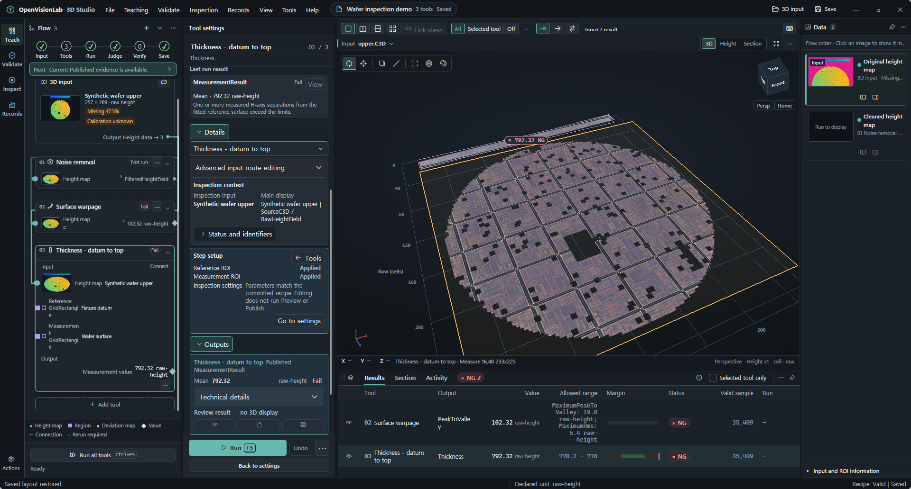
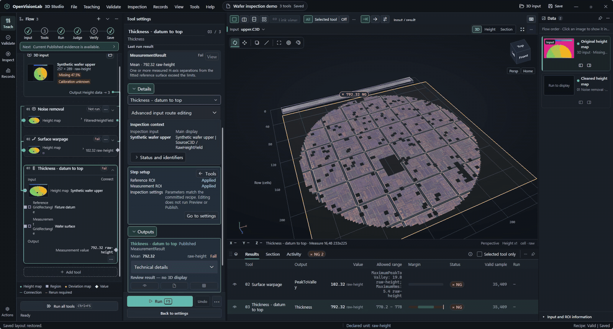
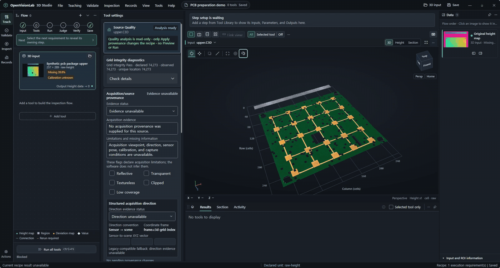
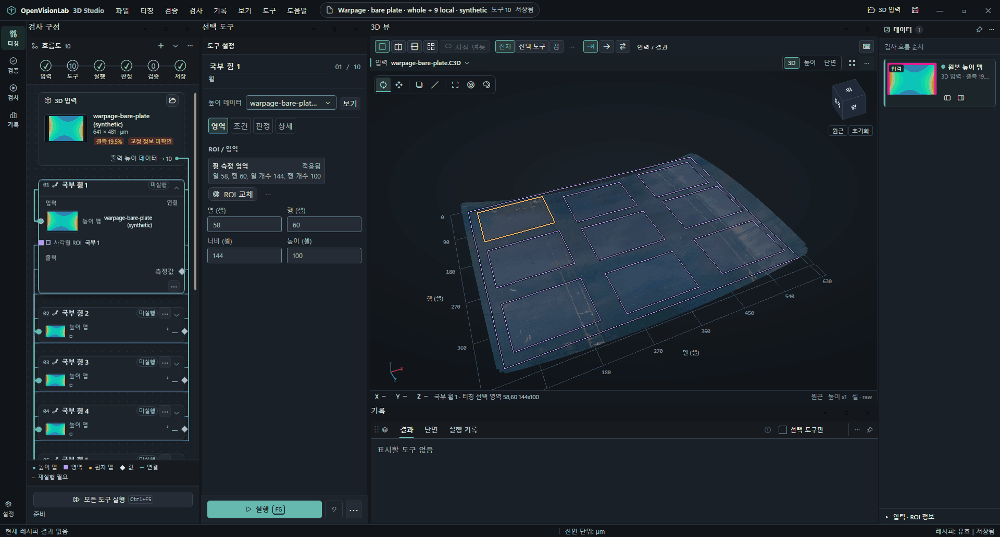
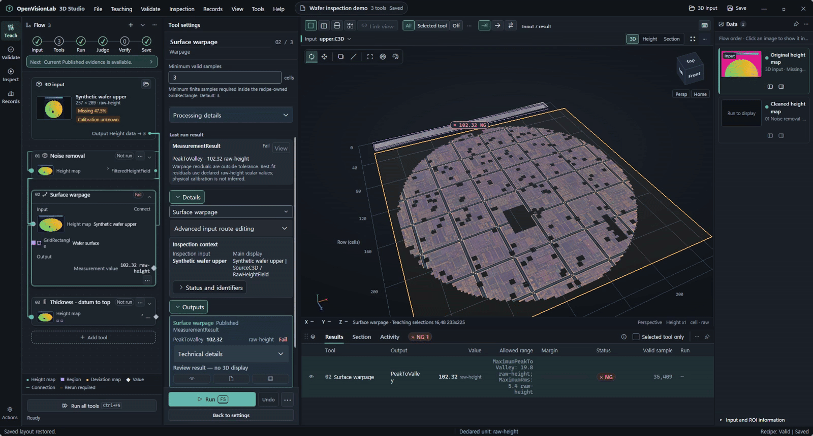
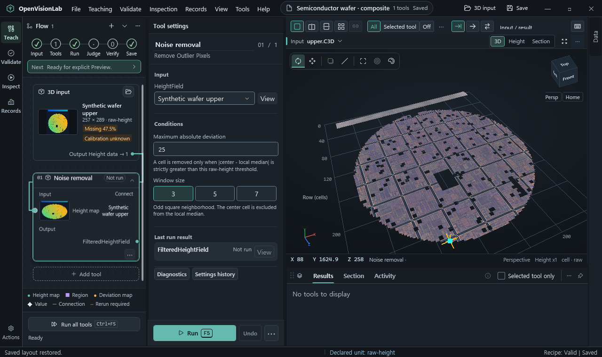

# OpenVisionLab 3D Studio

Teach a 3D inspection. Save the recipe. Inspect a batch of files.

[](https://github.com/Noah8218/OpenVisionLab-3D-Studio/actions/workflows/ci.yml)

OpenVisionLab 3D Studio is a Windows application for setting up and running
inspections on 3D data. Connect tool inputs, define inspection regions and set
limits, then review the measurements and results for each file.



## From input to inspection results

Open a recipe and its 3D input, adjust the teaching settings, run the inspection,
and open the results for a file.



1. Open a saved recipe, or create one and load a 3D file.
2. Add tools, connect compatible inputs, and define the required ROIs.
3. Apply the settings and run the selected tool to check its result.
4. Save the recipe, then add compatible files to the inspection list.
5. Run the inspection and review each file's status, values and limits.
6. Open a saved record to review the conditions and results from that run.

Loading a file, selecting a result or changing display settings does not start
an inspection.

## Build the tool sequence

Combine preparation and measurement tools in the recipe. Set the inputs,
regions and parameters for each step.



| Task | Tools | What to review |
| --- | --- | --- |
| Prepare a height map | Median filter, noise removal, leveling, ROI crop | Input and processed height maps |
| Measure surface warpage | Warpage | Peak-to-valley and RMS deviation within the ROI |
| Measure height separation | Thickness | Signed height difference from the reference plane to the measurement region |

Tool availability depends on the input type and required regions. Height-map
measurement tools require a compatible height-map input. Meshes and point
clouds can be viewed separately.

## Warpage measurement

Fit a reference plane to valid points in the selected ROI and review the
surface deviations as peak-to-valley (PV) and RMS values.



## Thickness measurement

Define a reference ROI and a measurement ROI. The Thickness tool reports the
signed H-axis height difference between the fitted reference plane and the
measurement region. This is datum-referenced height separation; it does not
measure a paired upper and lower surface.



## 3D viewing and textures

Use 3D, height-image and section views to inspect the input and tool results.
The viewer provides orbit, pan, fit, coordinate readouts and ROI overlays.
Displayed numbers use up to two decimal places; calculations and saved values
keep their original precision.

For a C3D height map, open **Color and height display**, then <strong>Choose image…</strong>
to select an image aligned to the full height map. **Show texture** switches
between the image and height colors; **Remove** clears the texture. The saved
selection is restored for the same recipe and source after the image file
is validated. Texture display does not change height values or inspection inputs.

<details>
<summary>Compact layout</summary>



</details>

The demonstrations use synthetic C3D data and an appearance image. Image
brightness is not a height measurement, and the example is not a calibrated
camera capture. The bundled [Thickness Coupon](3D/Samples/ThicknessCouponV1/README.md)
provides a ready-to-run recipe with declared `raw-height` units.

## Build from source

Follow [setup and project navigation](docs/OPENVISIONLAB_3D_SYSTEM_REQUIREMENTS_AND_SETUP.md).
Open `OpenVisionLab.ThreeDStudio.slnx` (or the equivalent `.sln`) and select
`OpenVisionLab.ThreeD.Shell` as the startup project.

```powershell
dotnet restore OpenVisionLab.ThreeDStudio.slnx
dotnet build OpenVisionLab.ThreeDStudio.slnx -c Release --no-restore
dotnet run --project src/OpenVisionLab.ThreeD.Shell/OpenVisionLab.ThreeD.Shell.csproj -c Release --no-build
```

The source build requires Windows, Git, PowerShell and the .NET SDK selected by
[global.json](global.json). The viewer also requires a compatible OpenGL driver.
The repository includes the required pinned dependencies in `third_party`.
NuGet package sources are configured in [NuGet.Config](NuGet.Config).
A separate SDK checkout is not required.

## Documentation

- [First inspection](docs/OPENVISIONLAB_3D_USER_TUTORIAL.md)
- [Sample data](docs/OPENVISIONLAB_3D_SAMPLE_DATA.md)
- [SDK package boundary](docs/OPENVISIONLAB_3D_VISION_SDK_PACKAGE_BOUNDARY_20260805.md)
- [Viewer Host display API](docs/OPENVISIONLAB_3D_VIEWER_HOST_DISPLAY_BOUNDARY_20260909.md)
- [Documentation index](docs/README.md)

## Version

Current version: `v0.7.0-dev`

This project uses explicit version numbers. This version is a development
source snapshot. Viewer Host API `1.2` adds optional C3D texture operations and
retains the existing construction and inspection contracts.

### Recent version history

#### `v0.7.0-dev` (2026-10-17)

- Added source-specific C3D textures and updated the teaching, settings,
  viewer, validation and inspection record screens.
- Corrected recipe source switching and improved recovery from file inspection
  failures.
- Limited displayed numbers to two decimal places while preserving calculation
  and storage precision; updated screenshots and workflow demonstrations.

#### `v0.6.0-dev` (2026-10-03)

- Updated the Graphite interface for tool setup, recipe nodes, viewer controls,
  results, recipe management and Tool Labs.
- Improved numeric input validation and access to coordinates and section
  controls in small panels.
- Updated pinned integration dependencies and source-build documentation.

#### `v0.5.7-dev` (2026-09-16)

- Improved C3D input checks, crop and grid identity, height measurement, and
  inspection records.
- Added checks for coordinates, thickness, source stability, memory limits and
  independent viewer use.

#### `v0.5.6-dev` (2026-09-14)

- Consolidated Shell, Workbench and Viewer command, state, event and resource
  ownership while preserving inspection and save/reopen behavior.
- Connected height-map and projection data to V2 exchange and result records.

#### `v0.5.5-dev` (2026-09-10)

- Moved viewer display and teaching coordination to the Workbench module while
  preserving viewer and recipe contracts.

#### `v0.5.4-dev` (2026-09-09)

- Added Nominal/Actual comparison snapshots for readiness, progress, evidence
  and deviation summaries.
- Updated Viewer Host API to `1.1` and retained existing construction paths.

#### `v0.5.3-dev` (2026-09-05)

- Limited the LAS/LAZ sample cache to the three most recently used entries.
- Prevented outdated asynchronous scene and status updates.

#### `v0.5.2-dev` (2026-09-05)

- Restored Verification sources required for clean public builds.
- Preserved recipe, inspection record and Viewer Host API contracts.

#### `v0.5.1-dev` (2026-09-05)

- Consolidated Shell workflow, dialog, persistence, startup and smoke-test
  resource ownership.
- Separated viewer loading, rendering resources, caches, transforms and colors.

#### `v0.5.0-dev` (2026-09-04)

- Improved asynchronous cancellation, UI-thread dispatch and resource cleanup.
- Added the Verification project and independent viewer consumer path.

## License

[Apache License 2.0](LICENSE). See [NOTICE](NOTICE) and the bundled dependency
notices for third-party attribution.
