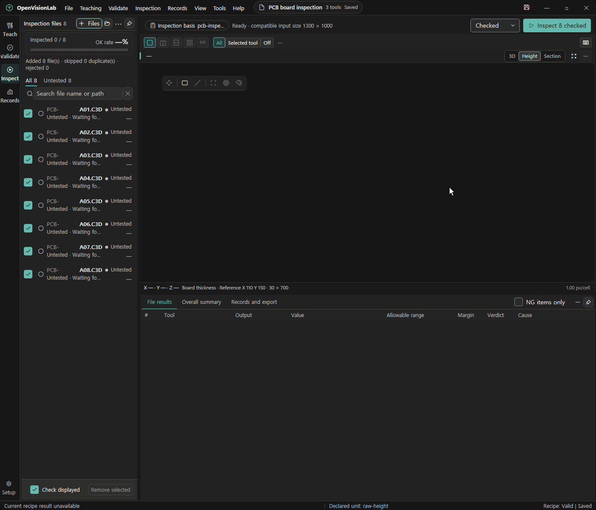
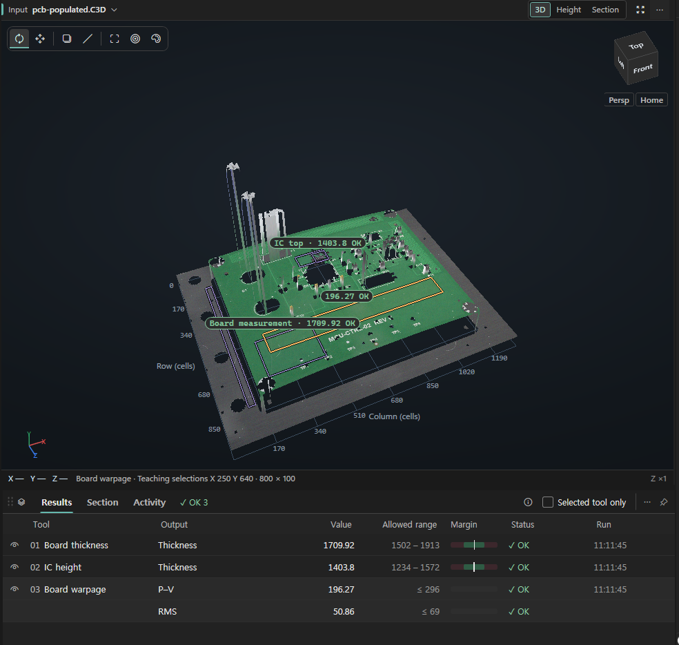
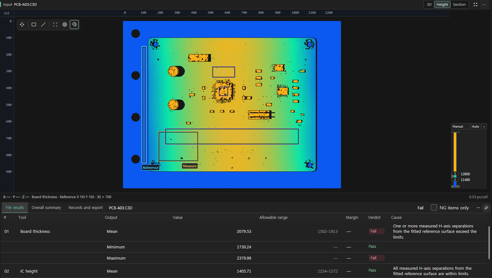
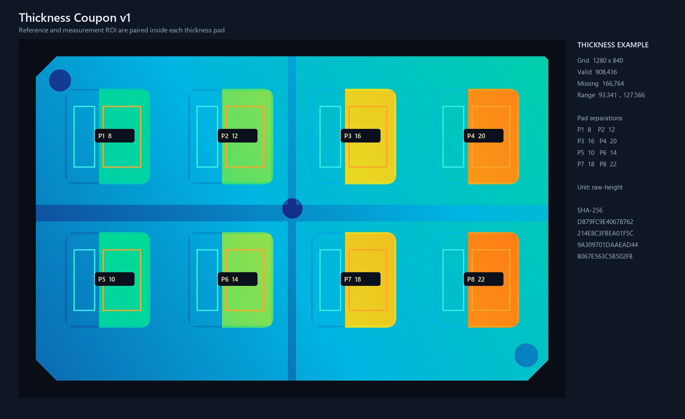
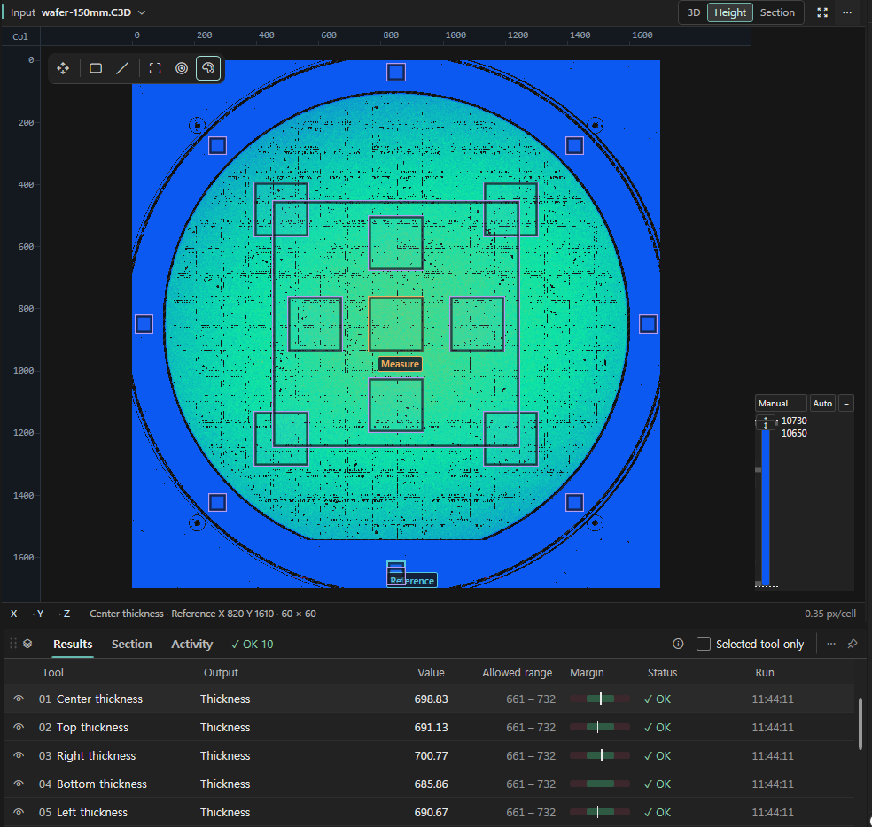
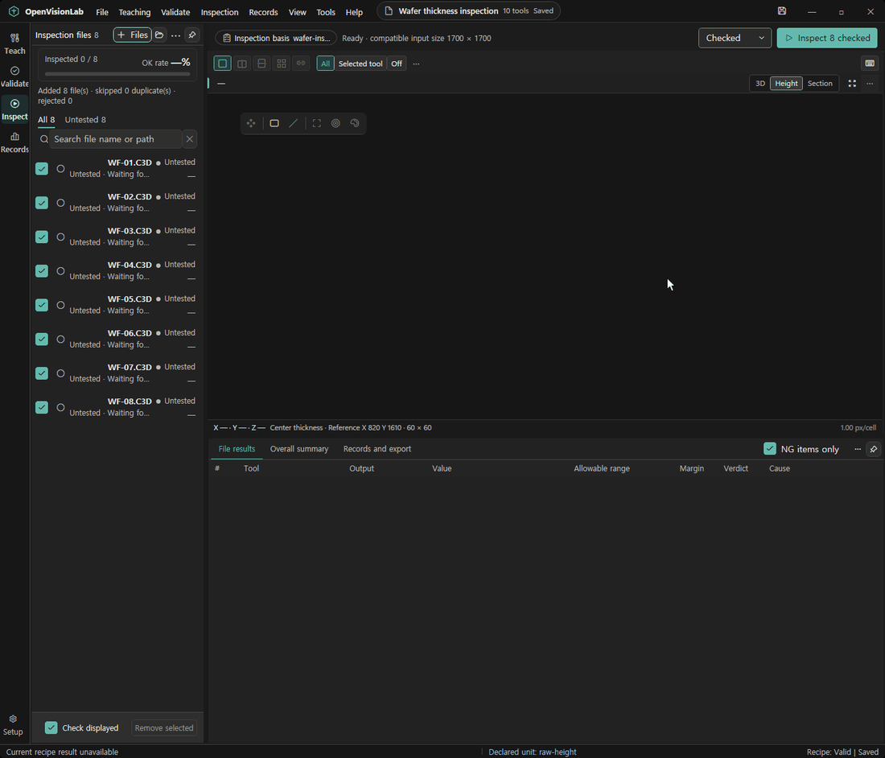
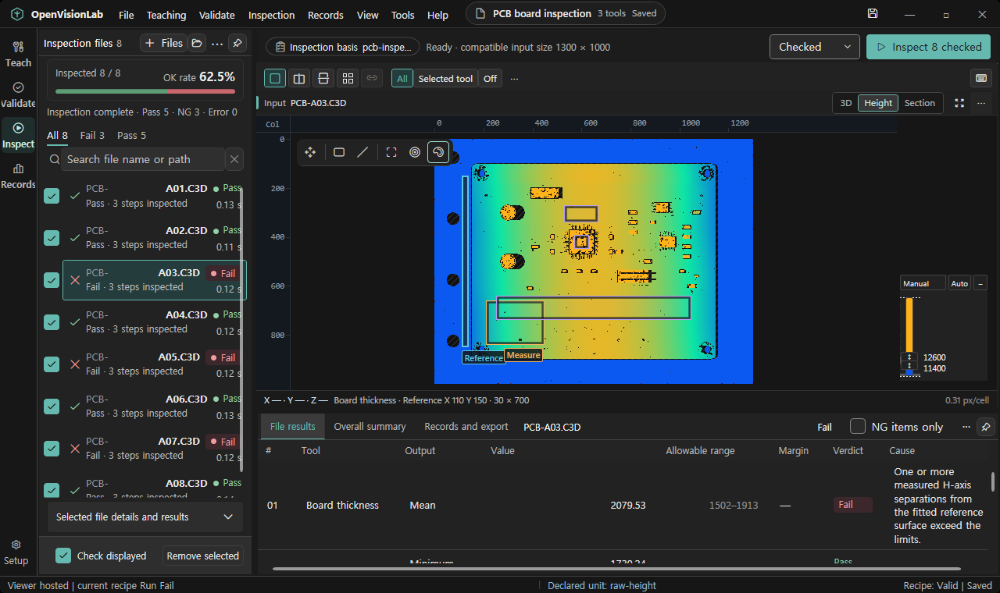

# OpenVisionLab 3D Studio

English | [한국어](README.ko.md)

Teach inspection steps on 3D data, save a recipe, and apply it to compatible files.

OpenVisionLab 3D Studio is a Windows desktop application for setting up and
repeating rule-based inspections on local 3D data. Connect tool inputs, define
inspection regions and set limits, then review the measurements and results
for each file.

[](https://github.com/Noah8218/OpenVisionLab-3D-Studio/actions/workflows/ci.yml)
  [](LICENSE)



One recipe inspects a lot of eight synthetic PCB scans. Five boards pass; the
bowed, twisted and thin boards fail, and each failure shows its value and limit.

## Try it in 3 steps

1. Clone `https://github.com/Noah8218/OpenVisionLab-3D-Studio.git` and enter the repository directory.
2. [Build and run the Shell](#build-from-source).
3. In **Recipe Center**, open the [Thickness Coupon Recipe](3D/Samples/ThicknessCouponV1/inspection-recipe.ov3d-recipe.json).
   Keep its paired input file in the same folder. See the [sample guide](3D/Samples/ThicknessCouponV1/README.md) for the input and declared
   `raw-height` units.

If you already have a self-contained Windows package, extract it and run
`OpenVisionLab.ThreeD.Shell.exe`. Its .NET runtime is included. Follow the
[Windows package quick start](docs/OPENVISIONLAB_3D_WINDOWS_PACKAGE_QUICK_START.md).

## What it does

- Connect compatible tool inputs and define ROIs in a Recipe.
- Prepare a height map and measure Warpage or datum-referenced Thickness.
- Inspect compatible files as a batch and review per-file results and saved Run Records.
- View 3D data, height images and sections, with aligned appearance textures on C3D height maps.

## From input to inspection results

Open a recipe and its 3D input, adjust the teaching settings, run the inspection,
and open the results for a file.



1. Open a saved recipe, or create one and load a 3D file.
2. Add tools, connect compatible inputs, and define the required ROIs.
3. Apply the settings and run the selected tool to check its result.
4. Save the recipe, then add compatible files to the inspection list.
5. Run the inspection and review each file's status, values and limits.
6. Open a saved record to review the conditions and results from that run.

Loading a file, selecting a result, editing parameters, restoring saved setup
or changing display settings does not start an inspection or sample validation.



## Included Thickness Coupon tutorial data

The repository and the self-contained package include a ready-to-run Thickness
Coupon with eight independently inspectable pads.



| Item | Included value |
| --- | --- |
| Height grid | 1280 × 840 |
| Layout | Eight pads in a 4 × 2 arrangement |
| Recipe | Eight Thickness steps with 16 editable ROIs |
| ROI contract | Reference and Measurement ROI remain on the same visible pad |
| Declared unit | `raw-height` |

Open this recipe from **Recipe Center → Open existing recipe**:

```text
3D\Samples\ThicknessCouponV1\inspection-recipe.ov3d-recipe.json
```

The recipe keeps its C3D input beside the recipe file, so the complete example
works after cloning or moving the whole package folder.

## Build the tool sequence

Combine preparation and measurement tools in the recipe. Set the inputs,
regions and parameters for each step. Run the complete recipe to pass each
created output to its connected downstream tools.

| Task | Tools | What to review |
| --- | --- | --- |
| Prepare a height map | Median filter, noise removal, leveling, nine-point surface compensation, ROI crop | Input and processed height maps |
| Measure surface warpage | Warpage | Peak-to-valley and RMS deviation within the ROI |
| Measure height separation | Thickness | Signed height difference from the reference plane to the measurement region |

Tool availability depends on the input type and required regions. Height-map
measurement tools require a compatible height-map input. Meshes and point
clouds can be viewed separately.

<details>
<summary>Other inspection tools and input limits</summary>

## Supported inspection work

| Area | Current workflow |
| --- | --- |
| Input review | C3D recipe-source loading plus Viewer-only GLB, STL, LAS, and LAZ import, with progress/cancel, visible limitations, source-quality evidence, and optional source-frame sensor-to-scene direction |
| Preparation | Median filtering, outlier removal, surface leveling and ROI crop. Each step saves a new height map and leaves the source unchanged; later tools can use that output |
| Height inspection | Thickness, Warpage, Plane Flatness, Height Deviation, Gap/Flush, Volume, and grid/region statistics |
| Geometry inspection | Point-pair and cross-section measurements, lines, planes, edges, landmarks, nominal/actual mesh comparison, and retained surface-match review |
| Teaching | Edit rectangle, circle and polygon regions in the linked 3D view and the full-resolution height image, with explicit Review, Apply, Cancel and Delete actions. A polygon is stored as its outline; the separate Grid Polygon Domain step turns it into a grid region output |
| Validation | Good, Bad, and Held-out sample roles; run results; failure analysis; threshold review; and held-out replay |
| Evidence | Viewer overlays, metrics, reports, output comparison, retained match review, headless Runner records, and a privacy-safe support ZIP |
| Recipe lifecycle | Save and restore ordered steps, inputs, parameters, ROI roles, outputs, and validation setup |

Measurements use the unit declared by the source. A `raw-height` result is not
automatically a calibrated physical measurement. Apply and verify the correct
calibration and acceptance limits before using physical tolerances.

Use the import button in the 3D Viewer toolbar for supported local 3D data.
`C3D` becomes the recipe input; `GLB`, `STL`, `LAS`, and `LAZ` are displayed in
the Viewer only and leave the recipe input unchanged. `.gltf`, OBJ, PCD, XYZ,
TIFF and RAW are not offered as general import formats.

Surface-match experiments remain review-only; they are not general inspection
tools.

</details>

## Warpage measurement

Fit a reference plane to valid points in the selected ROI and review the
surface deviations as peak-to-valley (PV) and RMS values. Nine-point surface
compensation creates a separate corrected height map for subsequent inspection;
the PCB example does not use it.

In the PCB example, the board warpage step reports a PV of 196.27 against a
limit of 296 on the reference board. The bowed and twisted boards exceed that
limit.

## Thickness measurement (height difference from a reference plane)

Define a reference ROI and a measurement ROI. The Thickness tool reports the
signed height difference along the height (H) axis between the fitted reference
plane and the measurement region. This is datum-referenced height separation;
it does not measure a paired upper and lower surface.

In the PCB example, board thickness is measured from the reference table to the
board (1709.92 against a limit of 1502–1913) and IC height from the board next
to the IC to the IC top (1403.8 against 1234–1572). The bowed board measures
2079.53 and fails the upper limit. Review the values and OK/Fail status in the 3D
Viewer and in the result table.

The wafer example measures thickness at nine points: the centre, four points at
mid radius and four on the diagonals. Each point has its own reference ROI on the
vacuum chuck, because the chuck plane is the datum.



A good wafer passes at all nine points and in the warpage step (PV ≤ 56).
In the lot of eight wafers, the three defective ones fail at different places: a
grinding pit only at the centre, a local bulge only at the point it covers, and a
twisted wafer at the two diagonal points on opposite sides. All three also fail the
warpage step. With **NG items only** on, the result table lists just the failing steps.
A failing step is marked on its first row; the Minimum and Maximum rows show which value left the range.



## 3D viewing and textures

Use 3D, height-image and section views to inspect the input and tool results.
The viewer provides orbit, pan, fit, coordinate readouts and ROI overlays.
Displayed numbers use up to two decimal places; calculations and saved values
keep their original precision.

For a C3D height map, open **Color and height display**, then **Choose image…**
to select an image aligned to the full height map. **Show texture** switches
between the image and height colors; **Remove** clears the texture. The saved
selection is restored for the same recipe and source after the image file
is validated. Texture display does not change height values or inspection inputs.

<details>
<summary>Compact layout</summary>



</details>

The PCB and wafer demonstrations use synthetic C3D scans from a laser-line-profiler
model. The PCB has a generated appearance texture and simulated bow, twist and
thin boards; the wafer has a simulated grinding pit, local bulge and twist. The
wafer scans contain no isolated outlier pixels, as if the sensor firmware had
rejected them, and the wafer height colours use a manual range of 10650–10730
`raw-height` so that the surface variation is visible. The PCB and wafer inputs and
recipes are not in the repository. Image brightness is not a height measurement,
and the examples are not calibrated camera captures. The screenshots and animations
show the English interface, and the mouse pointer in the animations is drawn at the
recorded pointer position.

The bundled [Thickness Coupon](3D/Samples/ThicknessCouponV1/README.md) provides a
ready-to-run recipe with declared `raw-height` units.

## Build from source

Use Windows 10 build 19041 or later, or Windows 11, on x64, with Git, PowerShell
5.1 or later, and the SDK selected by [global.json](global.json) (`10.0.300`, `latestFeature`).
The viewer requires an OpenGL-compatible GPU and driver. Open
`OpenVisionLab.ThreeDStudio.slnx` (or the equivalent `.sln`) and select
`OpenVisionLab.ThreeD.Shell` as the startup project.

```powershell
dotnet restore OpenVisionLab.ThreeDStudio.slnx
dotnet build OpenVisionLab.ThreeDStudio.slnx -c Release --no-restore
dotnet run --project src/OpenVisionLab.ThreeD.Shell/OpenVisionLab.ThreeD.Shell.csproj -c Release --no-build
```

Pinned dependencies are included in `third_party`; [NuGet.Config](NuGet.Config)
configures package sources. A separate SDK checkout is not required.
See [source setup and project navigation](docs/OPENVISIONLAB_3D_SYSTEM_REQUIREMENTS_AND_SETUP.md) for details.

Python 3.13 is required for the full independent verification suite, not for
a normal source build or application launch. See the
[development and verification guide](docs/OPENVISIONLAB_3D_SYSTEM_REQUIREMENTS_AND_SETUP.md#local-paths-and-tests)
for test commands.

<details>
<summary>Check or install source-build prerequisites</summary>

Check the machine without changing it:

```powershell
powershell -NoProfile -ExecutionPolicy Bypass -File scripts\setup-development-environment.ps1 -CheckOnly -Scope Build
```

Install missing build utilities by their fixed `winget` package IDs:

```powershell
powershell -NoProfile -ExecutionPolicy Bypass -File scripts\setup-development-environment.ps1 -InstallMissing -Scope Build
```

Use a short local clone path to avoid Windows and NuGet path-length failures.
The setup guide also covers a short NuGet cache and post-reinstall recovery.

</details>

The main application is `src/OpenVisionLab.ThreeD.Shell`.
`src/OpenVisionLab.ThreeDStudio` is a Viewer-only host. Follow the
[code navigation route](docs/OPENVISIONLAB_3D_SYSTEM_REQUIREMENTS_AND_SETUP.md#start-here)
when choosing a startup project.

## Create the self-contained Windows package

From a source clone:

```powershell
powershell -NoProfile -ExecutionPolicy Bypass -File scripts\publish-windows-app.ps1
```

The default output is
`artifacts\release\openvisionlab-3d-studio-win-x64`. It is a folder-based,
self-contained `win-x64` package with the application, samples, recipes,
operator documentation, license notices, and a SHA-256 manifest.

The package quick-start source is available at
[Windows package quick start](docs/OPENVISIONLAB_3D_WINDOWS_PACKAGE_QUICK_START.md).

## Keyboard shortcuts

| Shortcut | Action |
| --- | --- |
| `Ctrl+N` | New recipe |
| `Ctrl+O` | Open recipe |
| `Ctrl+Shift+O` | Open C3D height input |
| `Ctrl+S` | Save recipe |
| `Ctrl+Shift+S` | Save recipe as |
| `F5` | Run the selected tool |
| `Ctrl+F5` | Run the complete recipe |
| `Enter` | Apply the current ROI candidate |
| `Esc` | Cancel the current ROI candidate |
| `Delete` | Delete the selected supported ROI or recipe item |

## Documentation

**Use the app:** [First inspection](docs/OPENVISIONLAB_3D_USER_TUTORIAL.md) · [Sample data](docs/OPENVISIONLAB_3D_SAMPLE_DATA.md)

**Develop:** [SDK package boundary](docs/OPENVISIONLAB_3D_VISION_SDK_PACKAGE_BOUNDARY_20260805.md) · [Executable and Viewer Host projects](docs/OPENVISIONLAB_3D_SYSTEM_REQUIREMENTS_AND_SETUP.md#start-here) · [Documentation index](docs/README.md)

- [Development and verification guide](docs/OPENVISIONLAB_3D_SYSTEM_REQUIREMENTS_AND_SETUP.md#local-paths-and-tests)
- [Sample data and attribution](3D/PublicSamples/README.md)
- Source Quality and the privacy-safe support bundle: see the [documentation index](docs/README.md).

- [Contributor rules and versioning](AGENTS.md)

Current version: `v0.8.2-dev` · [Changelog](CHANGELOG.md)

## Status and limitations

- The latest hosted Workbench checks fail in docking/render cleanup, threshold-candidate review and one initial property-editor caption. Cause classification is still in progress; this snapshot is not fully CI-qualified.

- This version is a development source snapshot, not a production qualification. Tags, releases and deployment have separate approval steps.
- Measurement units follow the input data; the bundled example declares `raw-height` units and is not a calibrated camera capture.
- Tool selection can still pause the interface. Some native dialog recovery, floating-panel and held-button states remain unverified.

## Part of OpenVisionLab

| Project | What it does |
| --- | --- |
| [2D Workbench](https://github.com/Noah8218/OpenVisionLab) | Rule-based 2D inspection Recipes |
| [3D Studio](https://github.com/Noah8218/OpenVisionLab-3D-Studio) | 3D teaching, Thickness and Warpage |
| [Labeling Studio](https://github.com/Noah8218/OpenVisionLab-Labeling-Studio) | Labeling, training and model comparison |
| [Machine Studio](https://github.com/Noah8218/OpenVisionLab-Machine-Studio) | Machine simulation before hardware |
| [Vision SDK](https://github.com/Noah8218/OpenVisionLab-Vision-SDK) | Shared C# inspection library |

## License

OpenVisionLab 3D Studio is licensed under the
[Apache License 2.0](LICENSE). Commercial use, modification, and redistribution
are permitted under its terms. Distributions must retain the `LICENSE`,
[NOTICE](NOTICE), copyright, and required attribution notices. Third-party components
remain subject to their respective licenses.

```text
This project includes software developed by Noah Choi.
Copyright (c) 2026 Noah Choi.
```
