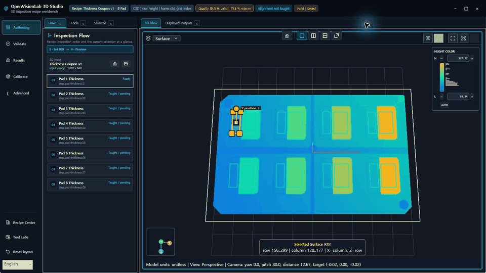
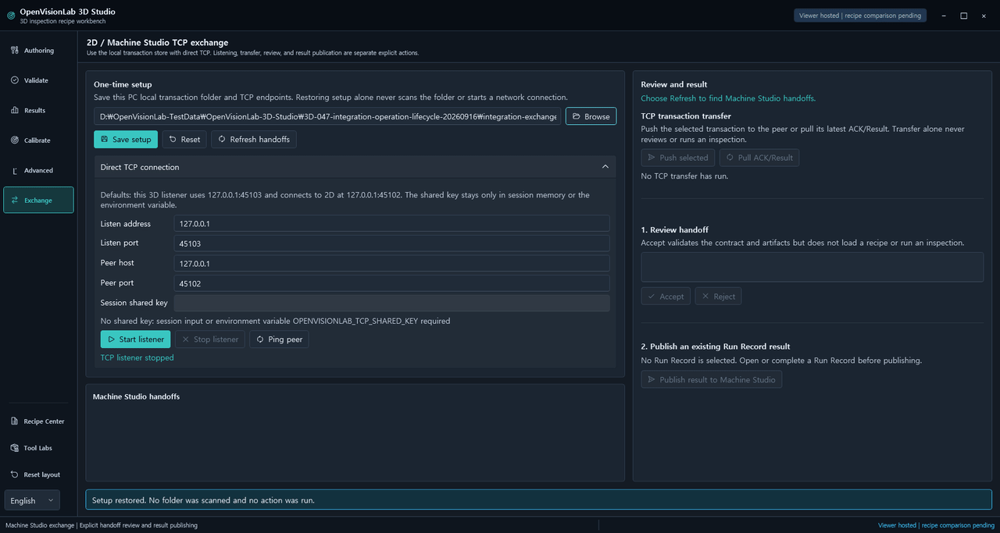

# OpenVisionLab 3D Studio

### Windows에서 규칙 기반 3D 검사 레시피를 만들고, 티칭하고, 검증하고, 다시 실행합니다

[](https://github.com/Noah8218/OpenVisionLab-3D-Studio/actions/workflows/ci.yml)


OpenVisionLab 3D Studio는 높이 데이터, 메시 또는 포인트 클라우드 데이터를
기반으로 3D 검사 레시피를 만들고, 실행하고, 결과를 확인하는 데스크톱
애플리케이션입니다.



## 버전

현재 버전: `v0.5.7-dev`

이 프로젝트는 명시적인 버전 번호를 사용합니다.

### 최근 버전 기록

#### `v0.5.7-dev` (2026-09-16)

- C3D 소스 승인, Crop/Axis/Grid 식별, Height Measurement 및 Run Record
  기록을 강화했습니다.
- 좌표·두께 계약, 소스 안정성, 메모리 승인, Viewer 호스트 수명 및
  독립적인 BinaryHost 소비 경로를 검증합니다.
- Viewer Host API `1.1`과 기존 레시피·저장 계약을 유지합니다.

#### `v0.5.6-dev` (2026-09-14)

- Shell, Workbench, Viewer의 MVVM 리팩터링을 명령 동작과 상태·이벤트·
  수명 소유자 기준으로 통합했습니다.
- Preview, Publish, Run, Save, Reopen 워크플로우를 유지하면서 독립적인
  Viewer 번들 소비자와 검증 경계를 정리했습니다.
- HeightMap/projection 소비 경로를 V2 교환 및 Run Record 게시 경로에
  연결하고 솔루션 수준 통합 테스트를 추가했습니다.

#### `v0.5.5-dev` (2026-09-10)

- Shell Workbench Viewer 표시 및 티칭 코디네이터를
  `Coordination/Workbench` 모듈로 이동했습니다.
- Viewer, 검사, 측정, 레시피 및 WPF View 동작과 계약을 유지했습니다.
- Host API 또는 저장 계약 버전을 변경하지 않았습니다.

#### `v0.5.4-dev` (2026-09-09)

- 준비 상태, 진행률, 증거 및 표시 샘플링 요약을 포함한 Nominal/Actual
  비교 표시 상태를 Viewer Host snapshot으로 노출했습니다.
- Tool Inspector, Result Summary, Linked View의 읽기 전용 바인딩을
  snapshot으로 연결했습니다.
- Viewer Host API 계약을 `1.1`로 올렸으며, 기존 `ViewerHostState`
  생성 방식은 유지했습니다.

#### `v0.5.3-dev` (2026-09-05)

- Viewer LAZ/LAS 샘플 캐시를 최근 사용 기준 세 개 항목으로 제한했습니다.
- 오래된 로드가 현재 상태로 표시되지 않도록 비동기 장면 상태와 telemetry의
  적용 시점을 정리했습니다.
- Viewer, 레시피, Run Record, 연동 및 raw-height 의미를 유지했습니다.

#### `v0.5.2-dev` (2026-09-05)

- 새 GitHub checkout에서 Verification 프로젝트가 컴파일되도록 검증 계약
  소스를 공개 레포에 복원했습니다.
- 레시피, Run Record, Viewer Host API 및 Preview/Publish/Run 경계를
  유지했습니다.
- CI와 빌드 무결성을 위한 패치로 기록했습니다.

#### `v0.5.1-dev` (2026-09-05)

- Shell 워크플로우, 대화상자, 저장 및 smoke 수명을 명시적 소유자로
  통합했습니다.
- Viewer 포인트 클라우드 로딩, 렌더링 리소스, 캐시, 변환 및 표시 색상
  소유자를 정리했습니다.
- 레시피, Run Record, 연동 및 raw-height 단위 의미를 유지했습니다.

#### `v0.5.0-dev` (2026-09-04)

- Shell과 Viewer의 수명, 취소, Dispatcher 및 리소스 소유권을 정리했습니다.
- 전용 Verification 프로젝트와 독립적인 Viewer binary-host 소비자 경로를
  추가했습니다.
- V2 연동 교환과 기존 레시피·저장 형식을 유지했습니다.

#### `v0.4.9-dev` (2026-09-01)

- C3D와 Viewer 전용 가져오기에 공통으로 사용하는 WPF 중립 소스 로드
  코디네이터를 추가했습니다.
- 최신 작업 취소와 오래된 Workbench 상태 억제를 적용했습니다.

#### `v0.4.8-dev` (2026-09-01)

- 취소 가능한 C3D 소스 디코딩과 렌더링 토폴로지 준비를 WPF Viewer
  컨트롤에서 별도 Loading 소유자로 이동했습니다.
- Viewer 로드 계약, OpenGL 적용 경계, 레시피 의미 및 Preview,
  Publish, Run 워크플로우를 유지했습니다.

## 개발 진행 상황

현재 Machine Studio와 OpenVisionLab 3D Studio 사이의 연동을 진행하고 있습니다.

현재 연결하고 있는 흐름은 다음과 같습니다.

```text
Machine Studio
    ↓ ThreeD/HeightMap Handoff
3D Studio 교환 화면
    ↓ 검토·수락·검사 실행
Result / Run Record
    ↓
Machine Studio 및 2D 결과 교환
```

현재 작업 중인 항목은 다음과 같습니다.

- Machine Studio HeightMap Handoff 교환 계약
- 교환 폴더와 TCP 통신 경로
- 3D Studio의 Handoff 수신, 검토, 수락 및 검사 실행
- 검사 결과와 Run Record 교환
- 2D/Image 데이터를 3D 검사 흐름으로 전달하는 경로
- 2D와 3D 결과 및 이미지 표시 연결
- Height Image 미리보기와 signed-delta 결과 처리 연결
- 저장된 결과를 다시 여는 흐름 연결



## 먼저 시작하기

현재 가진 형태에 맞는 경로를 선택합니다.

- **Windows 자체 포함 패키지:** 폴더의 압축을 풀고
  `OpenVisionLab.ThreeD.Shell.exe`를 실행한 뒤 패키지의 `README.md`를
  따릅니다. 패키지에는 .NET 런타임이 포함되어 있습니다.
- **GitHub 소스 복제:** 소스 빌드에 필요한 환경을 설치하고 저장소를
  복제한 뒤, 아래 명령으로 빌드하고 Shell을 실행합니다.

첫 번째 검사를 안내하는 내용은
[사용자 튜토리얼](docs/OPENVISIONLAB_3D_USER_TUTORIAL.md)을 참고합니다.

## 작업자 워크플로우

```mermaid
flowchart LR
    Source["3D 데이터 열기"] --> Quality["소스 품질 확인"]
    Quality --> Tool["검사 단계 추가 또는 선택"]
    Tool --> Teach["ROI와 파라미터 티칭"]
    Teach --> Preview["선택 단계 미리보기"]
    Preview --> Publish["승인된 미리보기 게시"]
    Publish --> Run["전체 레시피 실행"]
    Run --> Evidence["메트릭·오버레이·기록 검토"]
    Evidence --> Save["레시피 저장 및 다시 열기"]
```



Preview, Publish, Run 및 검증은 명시적인 작업입니다. 파라미터를 수정하거나
Viewer 표시 상태를 바꾸거나 저장된 설정을 다시 여는 것만으로 검사가 자동
실행되지는 않습니다.

Source Quality 화면에서는 소스 취득 정보, 관련 기록, 제한사항 및 필요한
소스 방향 정보를 기록할 수 있습니다. 입력한 내용은 **Apply source contract**
를 선택한 뒤 현재 검사 흐름에 적용됩니다.

## 포함된 Thickness Coupon 튜토리얼 데이터

저장소와 자체 포함 패키지에는 독립적으로 검사할 수 있는 8개 패드가 있는
바로 실행 가능한 Thickness Coupon이 포함되어 있습니다.


| 항목 | 포함된 값 |
| --- | --- |
| 높이 그리드 | 1280 × 840 |
| 배치 | 4 × 2 형태의 8개 패드 |
| 레시피 | 16개의 편집 가능한 ROI를 가진 8개 Thickness 단계 |
| ROI 계약 | 참조 ROI와 측정 ROI는 같은 표시 패드에 유지 |
| 선언 단위 | `raw-height` |

**Recipe Center → Open existing recipe**에서 다음 레시피를 엽니다.

```text
3D\Samples\ThicknessCouponV1\inspection-recipe.ov3d-recipe.json
```

레시피는 C3D 입력을 레시피 파일 옆에 보관하므로, 전체 패키지 폴더를
복제하거나 이동한 뒤에도 예제가 동작합니다.

## 지원하는 검사 작업

| 영역 | 현재 워크플로우 |
| --- | --- |
| 입력 검토 | C3D 레시피 소스 로딩과 Viewer 전용 GLB, STL, LAS, LAZ 가져오기. 진행률·취소, 표시 가능한 제한사항, 소스 품질 증거, 선택적인 소스 프레임 방향을 지원 |
| 준비 | 중앙값 필터링, 이상치 제거, 표면 수평 조정, 별도의 immutable HeightField로 만드는 명시적 ROI/Crop. 호환되는 후속 도구는 Published crop을 기준으로 티칭 가능 |
| 높이 검사 | Thickness, Warpage, Plane Flatness, Height Deviation, Gap/Flush, Volume 및 그리드·영역 통계 |
| 형상 검사 | 점 쌍 및 단면 측정, 선, 평면, 엣지, 랜드마크, nominal/actual 메시 비교, 결정적 표면 매칭 |
| 티칭 | GridRectangle, GridCircle, 순서가 있는 GridPolygon 선택을 위한 연결된 3D 및 전체 해상도 Height Image 편집. 명시적인 Review, Apply, Cancel, Delete 동작을 지원. GridPolygon은 작성용 외곽선만 저장하며 mask, region artifact 또는 후속 검사 입력을 만들지 않음 |
| 검증 | Good, Bad, Held-out 샘플 역할, 실행 결과, 실패 분석, 임계값 검토 및 held-out 재실행 |
| 증거 | Viewer 오버레이, 메트릭, 보고서, 출력 비교, 보존된 매칭 검토, headless Runner 기록 및 개인정보 보호형 지원 ZIP |
| 레시피 수명주기 | 순서가 있는 단계, 입력, 파라미터, ROI 역할, 출력 및 검증 설정 저장·복원 |

측정값은 소스에서 선언한 단위를 사용합니다.

지원되는 로컬 3D 데이터는 3D Viewer 도구 모음의 가져오기 버튼을 사용합니다.
`C3D`는 레시피 입력이 되고, `GLB`, `STL`, `LAS`, `LAZ`는 Viewer에만
표시되며 레시피 입력은 변경하지 않습니다. 애플리케이션은 `.gltf`, OBJ,
PCD, XYZ, TIFF 또는 RAW를 일반 가져오기 형식으로 제공하지 않습니다.

공유할 증거가 있으면 **Results → Run Record**에서
**Export privacy-safe support bundle**을 선택합니다. ZIP에는 manifest,
정리된 레시피, 최대 200개의 최신 세션 로그, 소스 식별자, 기록된 Source
Quality 및 현재 결과가 포함됩니다. 기본적으로 원본 3D 소스·메시 바이트,
절대 경로, 전체 애플리케이션 로그, 사용자·장비 식별자는 제외됩니다.
전송하기 전에 ZIP을 확인해야 합니다. 별도의 전체 Run Record export는
개인정보 보호형 공유 경로가 아닙니다.

## 새로 복제한 저장소에서 빌드 및 실행

### 사전 요구 사항

- x64 Windows 10 build 19041 이상 또는 Windows 11
- 최신 제조사 드라이버가 설치된 OpenGL 호환 GPU
- Git
- Windows PowerShell 5.1 이상
- .NET 10 계열의 .NET 10 SDK `10.0.300` 이상

Python 3.13은 저장소의 전체 독립 검증 모음에만 필요하며, 일반 소스 빌드나
애플리케이션 실행에는 필요하지 않습니다.

현재 컴퓨터를 변경하지 않고 확인합니다.

```powershell
powershell -NoProfile -ExecutionPolicy Bypass -File scripts\setup-development-environment.ps1 -CheckOnly -Scope Build
```

고정된 `winget` 패키지 ID를 사용하여 누락된 빌드 도구만 설치합니다.

```powershell
powershell -NoProfile -ExecutionPolicy Bypass -File scripts\setup-development-environment.ps1 -InstallMissing -Scope Build
```

Windows와 NuGet 경로 길이 문제를 피하려면 짧은 로컬 경로에 복제합니다.

```powershell
cd C:\src
git clone https://github.com/Noah8218/OpenVisionLab-3D-Studio.git
cd OpenVisionLab-3D-Studio
dotnet restore OpenVisionLab.ThreeDStudio.sln
dotnet build OpenVisionLab.ThreeDStudio.sln -c Release -p:Platform="Any CPU"
dotnet test --project tests\OpenVisionLab.ThreeD.Data.Tests\OpenVisionLab.ThreeD.Data.Tests.csproj -c Release --no-build --no-restore --minimum-expected-tests 2
dotnet run --no-build --project src\OpenVisionLab.ThreeD.Shell\OpenVisionLab.ThreeD.Shell.csproj -c Release
```

저장소에는 솔루션에 필요한 `OpenVisionLab.Vision3D`와 WPF PropertyGrid
패키지가 포함되어 있습니다. 이 프로젝트를 빌드하거나 실행하기 위해 별도의
`OpenVisionLab-Vision-SDK` checkout은 필요하지 않습니다.

전체 검증 도구, 정확한 패키지 ID, 짧은 NuGet 캐시 안내 및 재설치 후
복구 절차는 [시스템 요구 사항 및 설정](docs/OPENVISIONLAB_3D_SYSTEM_REQUIREMENTS_AND_SETUP.md)을 참고합니다.

## 자체 포함 Windows 패키지 만들기

소스 복제본에서 실행합니다.

```powershell
powershell -NoProfile -ExecutionPolicy Bypass -File scripts\publish-windows-app.ps1
```

기본 출력 경로는
`artifacts\release\openvisionlab-3d-studio-win-x64`입니다. 애플리케이션,
샘플, 레시피, 작업자 문서, 라이선스 안내 및 SHA-256 manifest가 포함된
폴더 기반 자체 포함 `win-x64` 패키지입니다.

패키지 빠른 시작 문서는
[Windows 패키지 빠른 시작](docs/OPENVISIONLAB_3D_WINDOWS_PACKAGE_QUICK_START.md)에서 확인할 수 있습니다.

## 키보드 단축키

| 단축키 | 동작 |
| --- | --- |
| `Ctrl+N` | 새 레시피 |
| `Ctrl+O` | 레시피 열기 |
| `Ctrl+Shift+O` | C3D 높이 입력 열기 |
| `Ctrl+S` | 레시피 저장 |
| `Ctrl+Shift+S` | 다른 이름으로 레시피 저장 |
| `F5` | 선택 단계 미리보기 |
| `Ctrl+F5` | 전체 레시피 실행 |
| `Enter` | 현재 ROI 후보 적용 |
| `Esc` | 현재 ROI 후보 취소 |
| `Delete` | 선택한 지원 ROI 또는 레시피 항목 삭제 |

## 문서

- [문서 안내](docs/README.md)
- [사용자 튜토리얼](docs/OPENVISIONLAB_3D_USER_TUTORIAL.md)
- [시스템 요구 사항 및 설정](docs/OPENVISIONLAB_3D_SYSTEM_REQUIREMENTS_AND_SETUP.md)
- [Windows 패키지 빠른 시작](docs/OPENVISIONLAB_3D_WINDOWS_PACKAGE_QUICK_START.md)
- [샘플 데이터](docs/OPENVISIONLAB_3D_SAMPLE_DATA.md)
- [변경 기록](CHANGELOG.md)
- [샘플 데이터 및 저작자 표시](3D/PublicSamples/README.md)

## 라이선스 및 저작자 표시

OpenVisionLab 3D Studio는
[Apache License 2.0](LICENSE)에 따라 라이선스가 부여됩니다. 해당 조건에
따라 상업적 사용, 수정 및 재배포가 가능합니다. 배포 시 `LICENSE`,
`NOTICE`, 저작권 및 필요한 저작자 표시를 유지해야 합니다. 타사 구성 요소는
각자의 라이선스를 따릅니다. Viewer 번들 의존성과 cvBlob 재배포 경계는
[Viewer 타사 고지](third_party/Viewer/THIRD-PARTY-NOTICES.txt)와
[의존성 맵](third_party/Viewer/VIEWER_DEPENDENCY_ATTRIBUTION.json)에
기록되어 있습니다. 해당 바이너리 번들을 배포하기 전에 정확한 LGPL 버전과
소스·재링크 의무를 확인해야 합니다.

```text
이 프로젝트에는 Noah Choi가 개발한 소프트웨어가 포함되어 있습니다.
Copyright (c) 2026 Noah Choi.
```
